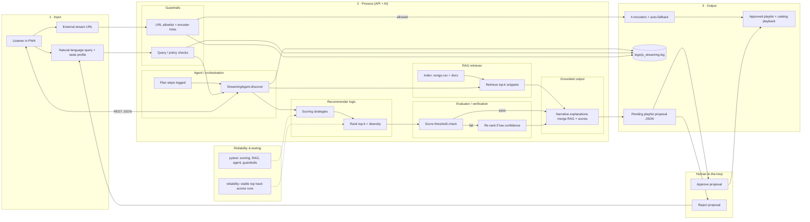

# System design — JS Streaming Music

This document satisfies **Step 2 (Design and Architecture)**. The diagram is defined in **Mermaid source** below and in [`architecture.mmd`](architecture.mmd).

## Components

| Component | Role in codebase |
|-----------|------------------|
| **Retriever (RAG)** | `src/rag/retriever.py` — indexes catalog + docs, retrieves snippets before explanations |
| **Agent / orchestration** | `src/agent/orchestrator.py` — plans steps, calls RAG + recommender, creates pending proposals |
| **Guardrails** | `src/guardrails/policies.py` — query policy, URL allowlist, focus-mode filtering |
| **Recommender** | `src/recommender.py` + `scoring_strategies.py` — Module 3 ranking |
| **Evaluator** | Agent verification: minimum score threshold; re-rank without diversity if confidence is low |
| **Tester** | `tests/` + `tests/reliability/test_stability.py` — pytest + stability experiments |
| **PWA + player** | `pwa/` — human UI, playlist approve/reject, encoder fallback |

## Data flow (input → process → output)

1. **Input:** User taste profile, optional text query, or external URL from the PWA.
2. **Process:** Guardrails → agent orchestration → RAG retrieval → score/rank → evaluator → grounded explanations.
3. **Output:** JSON proposal (human approval required) or approved playlist; playback via local media or encoder chain; audit log entries.

## Where humans and testing check AI results

- **Human-in-the-loop:** Discover returns `pending` until the user **Approve** or **Reject** (`/api/playlist/approve`, `/api/playlist/reject`).
- **Automated verification:** Unit tests assert guardrails, RAG summaries, and agent proposals; reliability tests assert deterministic top-track ranking for fixed profiles.
- **Runtime logging:** `logs/js_streaming.log` and `GET /api/logs/recent` record agent steps and guardrail decisions.

## Diagram (Mermaid)

## Optional preview

Export a PNG for slides or README from [Mermaid Live Editor](https://mermaid.live) by pasting `architecture.mmd`. Keep **this `.mmd` / `.md` source** in the repo for grading.